# my-own-collection

Personal, local, single-user web app to administer trading-card collections. Pokémon TCG first; schema is generic (`tcg` field) so other TCGs plug in via a new catalog provider.

## Overview

**Objective**: know what a card collection is worth, from trustworthy data, without any cloud service. Own catalog and own price history in a local MongoDB; real sold prices (not asking prices) drive the value.

**Shape**: Vite React SPA (:5180) -> FastAPI (:8100) -> MongoDB 7, all in docker compose, bound to 127.0.0.1, single user, no auth. One small extra service, the **fetcher**, runs on the host Mac and drives real Chrome to read PriceCharting, Cardmarket and alt.xyz (Cloudflare blocks anything else); the app only talks to it over localhost HTTP. Details: `architecture.md`.

**Data flow**: catalog import (pokemontcg.io) -> cards/sets -> you add stacks to the collection -> price refresh (API aggregates) and scraped fetch (sold listings) -> valuation (sold-based when >=3 sales in 90 d, else market) -> daily snapshot -> dashboard, movers, alerts. Rules: `pricing.md`.

**Status** (2026-11-05): phases 0-9 and the backlog are done: catalog, collection, wishlist, graded valuation, scraped sold prices, dashboard, alerts with macOS notification, scheduler, export/import, backup, TCGdex catalog provider (built, not switched). The scheduler and the backup schedule are built but not yet switched on (operator tasks in `roadmap.md`). Feature work follows `roadmap.md`: Steps 1-3 done (bulk price fetch for collection and wishlist, editable cost + acquisition type), Step 4 (collection list: pagination, filters, speed) is done; Step 5 (phone scanning) slice 1 is built and set up on the phone; name reading was calibrated on real photos (14 of 15 read).

## Features

- **Catalog**: cards and sets imported from an external API into own MongoDB. Idempotent (re-import is safe).
- **Search**: free text over name / set / number / types / rarity / rules text (accent-insensitive, multi-token AND, `4/102`, `#4`, `base1-4`). Filters: set, type, rarity, supertype, price range, has price (yes/no), owned only. Unpriced cards sort last on price ascending. Sort (Select above results): release (default), set number, name, price high/low. Set filter is a searchable Combobox; active filters show as removable chips with Clear all; a set header (logo, series, printed total, date) shows when a set is filtered; tiles show the set symbol. Ticking cards opens a bottom bar (Fetch prices, Select page, Clear). URL-synced filters.
- **Card detail**: image, metadata, prices per source, price history chart, sold-sales stats, owned stacks (+/−/remove), add-to-collection form.
- **Collection** (graded copies without a graded price are shown as "needs price" and left out of Value/P-L; "Fetch missing prices" fetches just those cards; "Fetch all prices" (mode picker) and a per-stack "Fetch prices for this stack" sit on this page too; adding a card from its page starts a price fetch automatically, best effort):  stacks of identical copies (card + variant + language + condition or grading). Raw copies need a condition; graded copies need grader + grade (optional cert, which makes the slab unique). Cost and acquisition per stack: type (Purchased / Pulled / Traded / Gift / Other), price per copy (or total for the stack, stored as the average), currency, date, where bought, notes; edit later from the details drawer ("Edit cost", with an edit history and "Restore previous") or the pencil on the card page. Select rows with the checkboxes -> "Edit cost & type" to change several stacks at once (only filled fields change). To fix stacks without a cost: filter "No cost" (or the link under the KPIs), select all, set type/price/date. P/L counts only stacks with a cost; "P/L excl. pulled" leaves Pulled stacks out. Page = KPI strip, value-over-time chart (daily snapshots, 30d/90d/1y/all), filters (search by name/number, set, rarity, card type, raw/graded, grader, grade, condition, language, acquired how, profit/loss, price per copy min-max, needs price, price stale, no cost; options carry stack counts), a sort picker plus sortable columns (value, cost, P/L, name, set, qty, date added, last price update; unvalued stacks always last), real pagination (25-200 per page, server-side, fast at 5,000+ stacks). Presets row: built-ins (Graded only, Cheap bulk < EUR 1, Needs price, Price stale, No cost, Losing money) and your own ("Save current" names the active filters + sort; they are stored in the database, so they are on every device). When a filter is active a strip shows count, value, cost and P/L of the filtered set. Table | Grid switch (image tiles; the choice is remembered). Filters, sort and page live in the URL (`/collection?sort=pl&page=2`), so back and bookmarks work. Coming back to the page shows the last result at once and refreshes quietly. The Wishlist page has the same search, sort, presets and grid. Row click or the chevron opens a details drawer (value, why estimated, source compare); the bell links to `/alerts?stack=<id>` which prefills the alert form. Graded copies are valued at their own grade's price (sold median when >=3 sales in 90 d, else market); each value shows a `sold`/`market` badge and source, and `≈` with a reason when it is a fallback (grade bucket, lower grade, raw price) - see `pricing.md`.
- **Wishlist** (nav "Wishlist", `/wishlist`): cards you want, as raw or a specific grade (PSA 9...), with an optional target price in EUR and a note. Priced like one owned copy (a graded want without a graded price shows "needs price", never the raw price). Page = KPIs (wanted, target hit, cost of all hits), chips (All / Target hit / No price), table with price now, target, gap, "target hit" badge, edit (target, note, alert) and remove (confirm). Add from the card page ("Wishlist" panel: Raw/Graded, target, "Alert below target"; adding starts a price fetch best effort); Search tiles show a heart on wished cards. Setting a target keeps one linked alert rule ("Wishlist <card> below <target>"), removed with the entry or when the target is cleared; the rule is checked like every other (after fetch / refresh / snapshot / Check now). Wishlist cards are included in the scheduled fetch. The wishlist never counts in collection totals. Not in export/import (it is in the mongo backup).
- **Prices**: aggregate market prices from TCGplayer (USD) and Cardmarket (EUR), converted to the base currency (default EUR). Manual sale entry for sources without an API (e.g. alt.xyz).
- **Dashboard** (insight; Collection is the inventory): KPI strip (value, 30d change, P/L with % vs cost, P/L excluding pulled cards, cost with a count of stacks missing it), value-over-time chart (7d..all; "Compare sources" adds one line per source, hollow dots = that source valued something thin or not exact), "Where the value is" ranked bars by set / rarity / condition / language / TCG (top 10 + Other, with % share), top holdings (8 most valuable stacks), top movers up/down (sold-based, graded-aware; need the same kind of price now and N days ago), a data-quality card (% sold-based, estimated / needs graded price / no data counts, fresh-price count "N / M cards (<= 7 d)" with stale / never-fetched, "Fetch missing prices", "Fetch all prices"), and a collapsed per-source comparison table. 30d change only compares snapshots taken since graded valuation.
- **Settings** (tabs Catalog | Prices | Automation | Data | Jobs, `?tab=`): Catalog = actions split into "Selected sets" and "Everything" (Import all / Refresh all ask for confirmation), searchable set table grouped by series with filter chips (not imported / incomplete / no prices) and per-series select-all; Prices = one "Price fetching" card (scope selected sets / owned / missing prices, source chips, force) plus the price-source table; Automation = scheduler, fetcher, next runs; Data = export, drop-zone import; Jobs = readable rows (duration, one-line summary, expandable raw stats, type filter, last 20). Catalog notes: set picker (per-set priced/total) to import or refresh prices for chosen sets, "Retry incomplete" for sets with fewer cards than upstream `total` (shown red as "N missing") or that failed the last full import, provider status, job log. One job per type at a time (second start returns 409; buttons disable while running).

- **Scraped fetch UI** (needs the host fetcher running: `scripts/fetcher.sh start` (also `stop|status|logs`); a badge shows up / not running): card detail -> "Fetch prices" (pick sources, `force` ignores the 24 h cache); per-source status line with last result, link, and a candidate picker when a match is ambiguous ("Use this" confirms and re-fetches that source, "Reset match" undoes it); Settings -> Prices -> "Price fetching" (selected sets, owned collection or missing prices, with progress and failure / needs-match lists); Search -> tick cards -> "Fetch prices for N selected". Scheduled runs never pause for login (see Scheduler). If a site needs a login a manual run pauses with "Waiting for login (<site>)": log in in the Chrome window that opened, the fetch continues.
- **Fetch all prices** (Dashboard, Collection, Wishlist, Settings -> Prices): pick the cards (Collection / Wishlist / Both; both = collection first, duplicates fetched once; the Wishlist page defaults to Wishlist) and all / never fetched / stale (N days) / most valuable first, press the button and leave; progress "42 / 120 done, 3 failed, ~6 min left" is server-side, so it is there when you return. Pause / Resume / Cancel; start again later and it skips what just succeeded. At the end: "118 cards updated, 2 need attention" plus a macOS notification (needs the fetcher notifier), and a table of failures (card, source, reason: no match / blocked / layout changed) with "Retry failed" and, for no match, "Choose match" (opens the card's Sources picker). After a run target alerts are re-evaluated at once, so "below target" notifications do not wait ("N alerts fired" is shown in the summary). The Wishlist page shows fresh / stale / never counts (`GET /api/wishlist/prices`; the Dashboard data-quality card adds the wishlist-only counts). Scheduler: `SCHEDULER_FETCH_WISHLIST` (default true) includes wishlisted cards in the daily fetch. API: `POST /api/admin/prices/fetch {"mode":"stale","stale_days":7,"scope":"both"}`, `GET .../fetch/current`, `POST .../fetch/control {"action":"pause"}`, `POST .../fetch/retry`.
- **Scraped fetch API**: `curl -X POST localhost:8100/api/admin/prices/fetch -H 'content-type: application/json' -d '{"cards":["pokemon:sv3pt5-205"],"sources":["altxyz"],"force":true}'`; targets: `cards`, `sets`, `owned`. Progress in `GET /api/admin/jobs` (`stats.waiting_login`, `needs_match_list`, `failures`). One card: `POST /api/cards/{id}/fetch-prices`.

## Usage

```bash
cp .env.example .env            # set MONGO_ROOT_PASSWORD
docker compose up -d --build    # mongo + api + web
```

| What | URL |
|---|---|
| Web | http://localhost:5180 |
| API + Swagger | http://localhost:8100/docs |

1. Settings -> Import: type a set id (e.g. `base1`) for a quick start, or leave empty for the full catalog (~20k cards, 30+ min, runs in the background; watch the Jobs tab).
2. Search -> open a card -> Add to collection (Raw | Graded switch, condition chips or grader + grade selects, quantity stepper, price paid, estimated value shown before adding).
3. Dashboard -> Refresh prices (re-fetches owned cards' sets, then takes today's snapshot). History needs 2+ snapshots to draw.

Data lives in docker volume `moc_mongo_data`. Never `docker compose down -v`. The backend has no auto-reload: `docker compose restart app` after edits.

### Price fetcher (host Mac, optional: the app works without it, but scraped prices need it)

Needs Google Chrome installed. One command: `scripts/fetcher.sh start` (check `curl localhost:8110/health`); nothing else is needed from you unless a Chrome window opens with a Cloudflare / login page: solve it there, the fetch continues. Chrome closes after 120 s idle. Setup (first time) and details: `fetcher/README.md` (`python3 -m venv .venv && pip install -e .[dev]`, then `python -m fetcher`). It only opens Chrome while a fetch runs. The same process shows the macOS alert notifications (see Alerts).

Tests: see `CLAUDE.md` for the commands. Backend: pytest against a throwaway mongo. Frontend: `docker compose exec web npm test` (vitest + jsdom + Testing Library; `fetch` is mocked via `web/src/test/utils.tsx`, no network). UI failure handling: `QueryState`/`QueryError` (`web/src/components/QueryState.tsx`) show an error box with Retry when a query fails; `ErrorBoundary` catches render crashes; unknown URLs show a NotFound page.

## More

- `architecture.md` - technical design, data model, API
- `pricing.md` - price semantics, valuation rules, sources
- `decisions.md` - discovery answers and source findings
- `backup.md` - backup, verify, restore, scheduling
- `roadmap.md` - what is done, your pending operator tasks, open next steps

## Demo data (UI checks without touching your collection)

```bash
docker compose run --rm app python -m app.scripts.demo_db create   # seeds owncollection_demo (needs Mew ex 151 #205 data in the real DB)
docker compose -f docker-compose.yml -f docker-compose.demo.yml up -d app   # app on the demo DB
docker compose up -d app                                            # back to the real DB
docker compose run --rm app python -m app.scripts.demo_db drop     # delete the demo DB
```

## Screenshots

1600 px wide, dark then light (`docs/screenshots/`). Card page is truncated at 2600 px.

| Page | Dark | Light |
|---|---|---|
| Search | 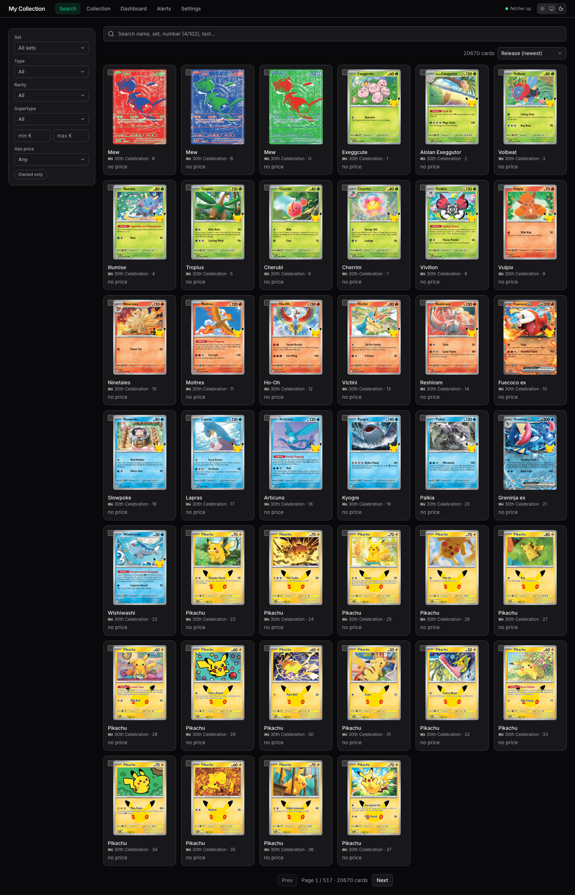 | 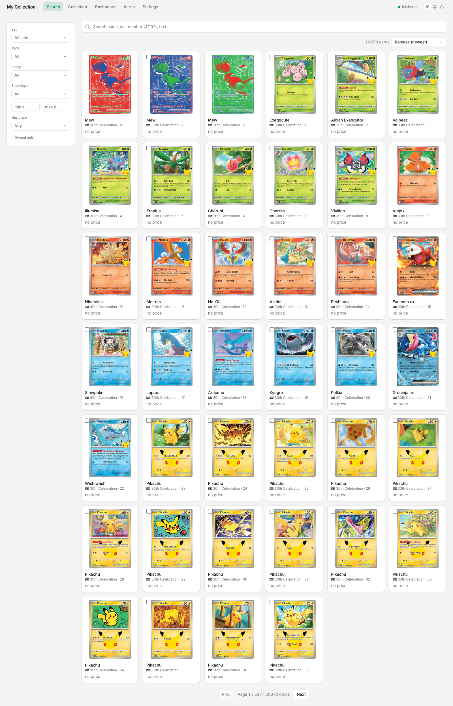 |
| Collection | 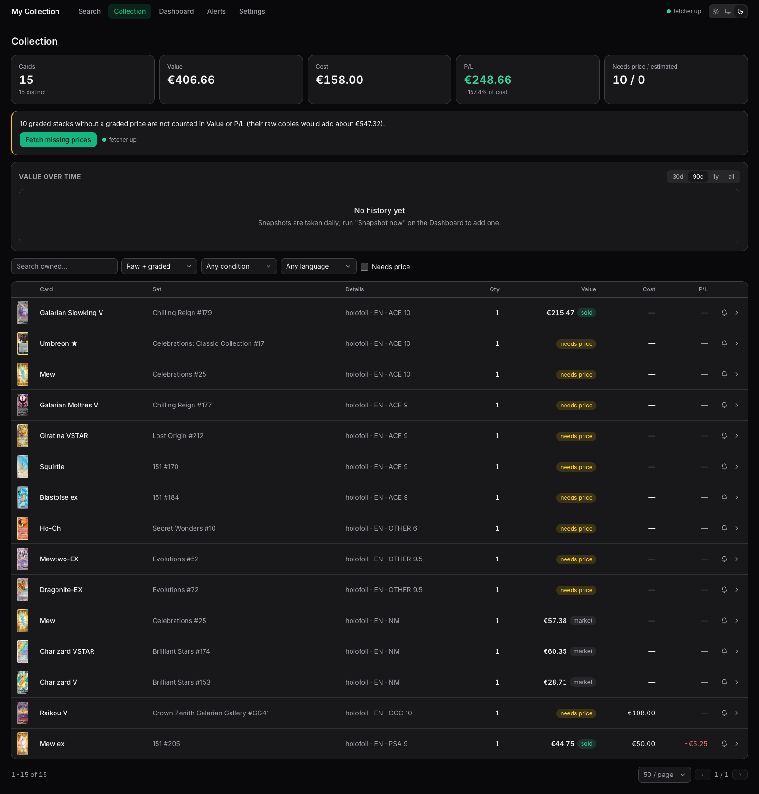 | 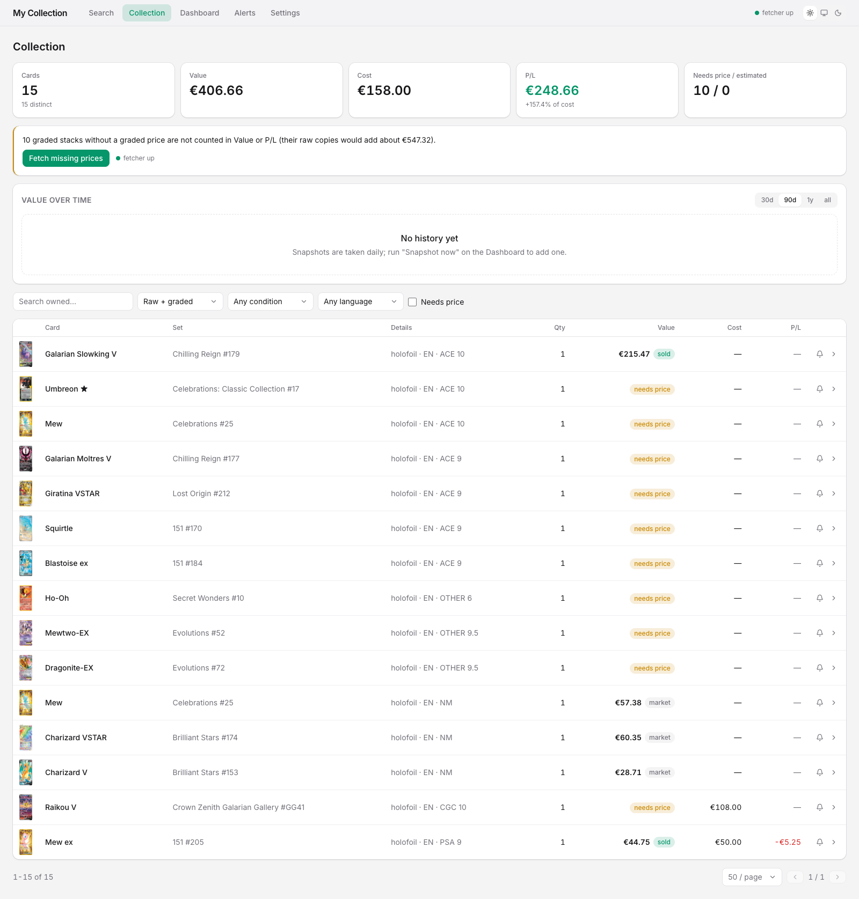 |
| Dashboard | 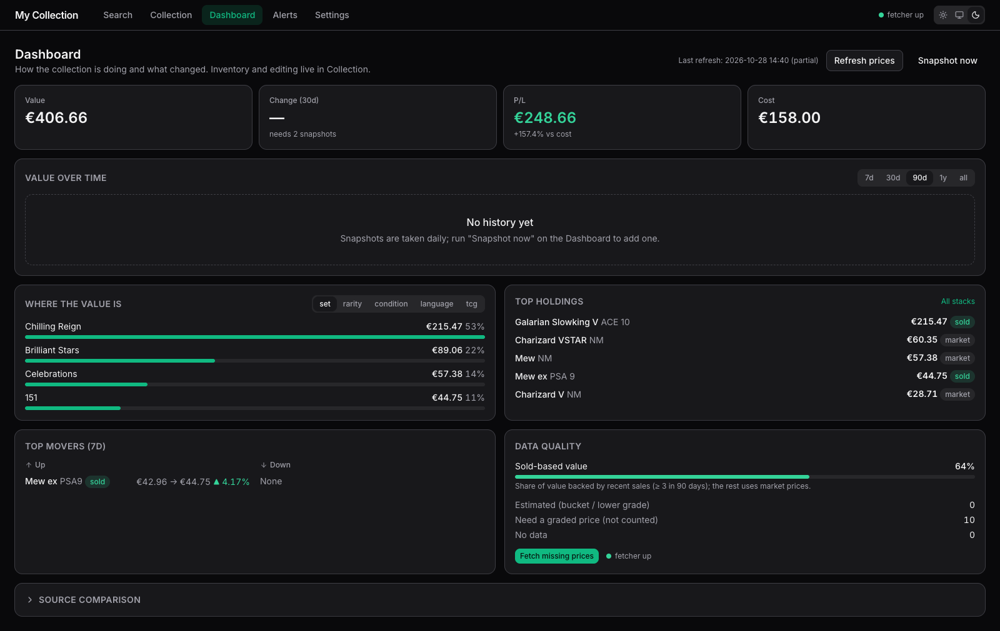 | 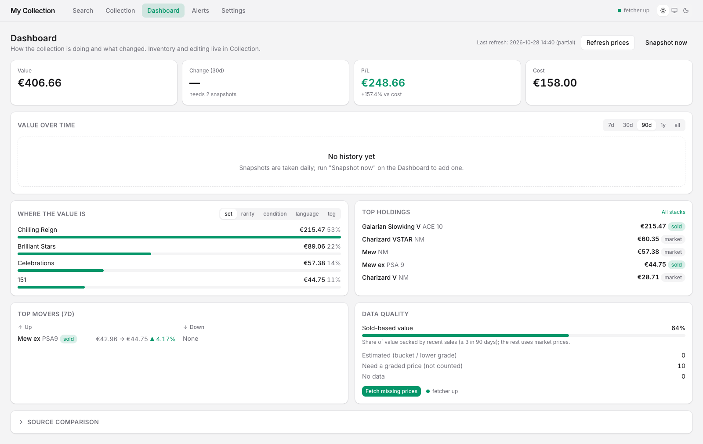 |
| Alerts | 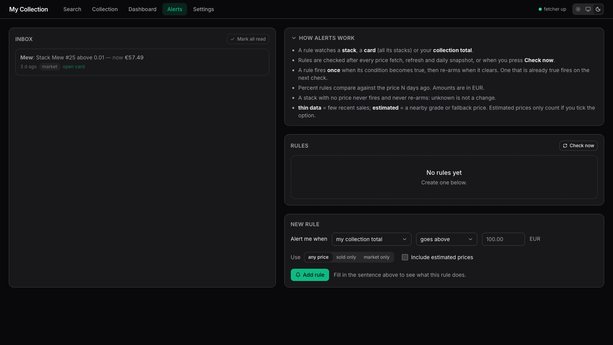 | 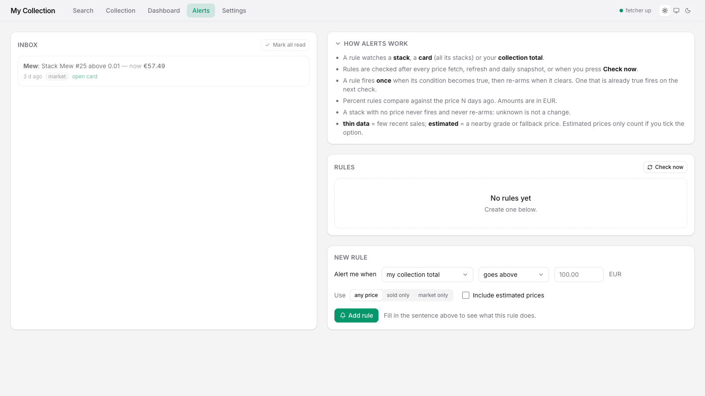 |
| Settings | 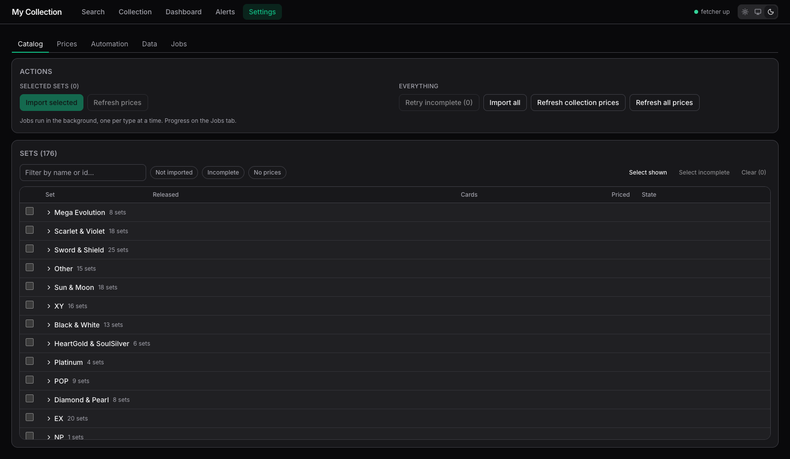 | 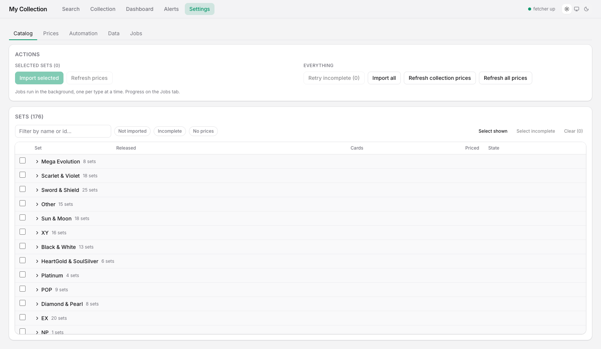 |
| Card | 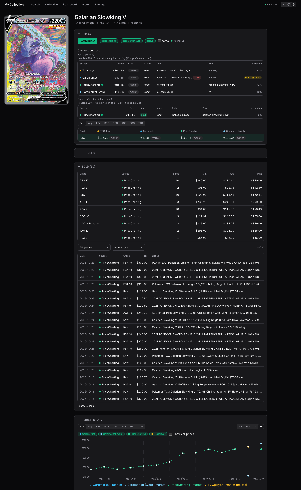 | 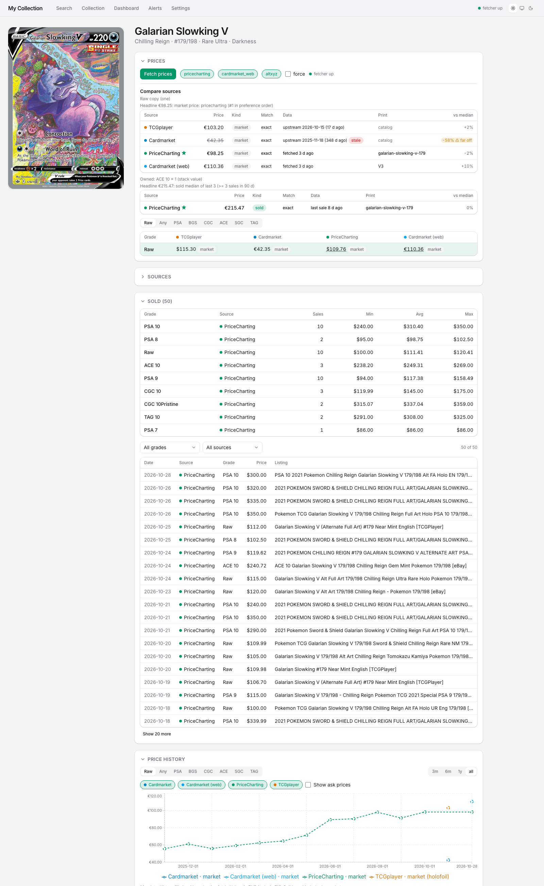 |

## Scan cards with your phone
Point the phone at a card: the app reads the name, shows every version (set, number, rarity, year, variants, price, "Own N"), you tap the one you hold, pick condition, add. Nothing is added before that last tap. A card you already own in the same condition joins that stack. The laptop refreshes by itself and shows "Added: Charizard, Base".

How the phone reaches the app (decision D1, `decisions.md`): **Tailscale**. The phone opens `https://<computer>.<tailnet>.ts.net/scan` over your private tailnet. Nothing is opened on your Wi-Fi, no certificates to install, and only your Tailscale login is let in. The gate only passes four scan calls, never the rest of the API (collection list, export, admin...).

One-time setup:
1. Install Tailscale on the computer and the phone, same account. In the Tailscale admin page turn on **MagicDNS** and **HTTPS certificates**.
2. `scripts/lan.sh setup <computer>.<tailnet>.ts.net <your-tailscale-login>` (writes the gitignored `lan/lan.env`; never touches `.env`).
3. `scripts/lan.sh up` (restarts the app, builds the phone page, starts the gate on `127.0.0.1:5443`). It prints the line to run once: `tailscale serve --bg --https=443 http://127.0.0.1:5443`.
4. Collection page > **Add by scanning** shows the address as a QR code. Open it on the phone (Tailscale on); optionally Add to Home Screen.

Name reading: the app finds the card in the photo, reads the name area in a few passes and lists every print of that name; a wide photo from the phone camera app works as well as the live view. If nothing is read, type a few letters of the name in the search box. A blank or 0 cost counts as "no cost" (excluded from P/L).

Daily use: Tailscale on, open the page, **Scan** (or **Photo**, which opens the phone's own camera app), tap the version, tap condition, **Add**. Re-run `scripts/lan.sh up` after frontend changes (it rebuilds the phone page). `scripts/lan.sh down` closes the gate; `status` shows it.
Text is read locally with Tesseract inside the app container (no paid service, no upload outside your machine). Cards the reader cannot read: type the name. The card is found in the photo as a rectangle (any table colour, tilt or size; a card cut off by the frame falls back to the older method), flattened, and the name, collector number (`127/182`) and set code are read from it. The picker lists every print that fits, best first, and tells you what agreed ("name + number + printed total"); you always tap the one you hold. Glare on a sleeve can still defeat the number: then you get the name's prints and pick. Set code matching only works for sets imported after 2026-11-07 (re-import a set to add it). If the phone says it can't reach the computer: Tailscale on both, computer awake. Base Set style prints (1st Edition / Shadowless) are not separate in the catalog: the picker warns, check the stamp yourself.

## Look and theme
Dark by default. Header toggle: light / system / dark (remembered in the browser). UI building blocks live in `web/src/components/ui`.

## Export / import
Settings -> Data: JSON (lossless) or CSV (spreadsheet; money in cents; includes `acquired_type`). Import matches stacks by key, so re-importing the same file changes nothing ("set quantities") or adds quantities ("add"). API: `GET /api/collection/export?format=json|csv`, `POST /api/collection/import?format=&mode=set|add` (file as raw body).

## Backup
`scripts/backup.sh` dumps the whole database to `backups/`; `scripts/restore.sh` restores (or `--to-scratch` verifies). Scheduling, retention, restore steps: `docs/backup.md`.

## Alerts
Alerts page (nav badge = unread; two columns: Inbox left; "How alerts work" explainer, Rules table and the new-rule form right). The form reads as a sentence ("Alert me when [collection total | a card | a single stack] [searchable picker] [goes above | drops below | rises by | falls by] [amount] ...") with a live preview of the resulting rule; the picker searches all owned stacks server-side with "Show more" (no 200 cap). Rules can be disabled or deleted (delete asks to confirm). Add a rule on a stack, a card, a wishlist card or the collection total (above/below a EUR amount, or up/down N% over D days; sold/market/any; optionally include estimated values). Rules are checked after every price fetch, refresh and snapshot ("Check now" re-checks). Each crossing gives one inbox item; the rule re-arms when the condition clears. A rule that is already true fires on the next check. The inbox also warns when a scheduled fetch was skipped (fetcher down / login needed). While the host fetcher runs it also shows a macOS notification for each new alert (one summary when several arrive; settings in `fetcher/README.md`).

## Scheduler
Off by default. Set `SCHEDULER_ENABLED=true` in `.env` and `docker compose restart app`. Daily catalog-API refresh, scraped fetch of owned cards (needs `scripts/fetcher.sh start`, else the run shows as `skipped`; sites needing login are skipped, so log in via a manual fetch now and then), snapshot, weekly catalog import, daily prune of old read alerts (`ALERT_EVENTS_KEEP_DAYS`, 90); missed runs are caught up at boot. Settings shows next runs and a trigger column in the Jobs table. Cron/cap settings: `docs/architecture.md`. Restart the host fetcher after updating (`scripts/fetcher.sh stop && scripts/fetcher.sh start`) so it knows the unattended flag.

## Card page prices
One grade selector (Raw | Any | PSA | BGS | CGC ... then grade 10 to 1) drives both the price matrix and the history chart and is kept in the URL (`?grade=PSA10`). The matrix shows only the chosen company's rows, hides empty grades/columns ("Show empty grades" reveals them) and highlights the selected row. "Any" has no grade 10 (PriceCharting publishes company-agnostic grades up to 9.5 only). Sold section: one stats table plus filterable sales (grade, source, 20 at a time, listing link). Chart: range 3m/6m/1y/all, ask series hidden unless ticked, one point shows a hint. Source status lives in a collapsed "Sources" section.

